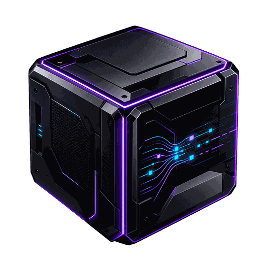

## 🔐 Authentication on Railway (v1.9)

Set `BLACKBOX_DEPLOY_MODE=hybrid` to keep the synthetic gallery public but require username/password sessions for private captures, reports, and case storage. Browser sign-in uses a 12-hour, HttpOnly, Secure, SameSite=Strict session cookie with CSRF protection. Existing HTTP Basic account access remains available in `multi-user` mode.

**Required Railway environment variables** (do not commit values to GitHub):

```text
BLACKBOX_DEPLOY_MODE=hybrid
BLACKBOX_PUBLIC_HOST=blackbox-investigator-production.up.railway.app
BLACKBOX_BOOTSTRAP_USER=<your account username>
BLACKBOX_BOOTSTRAP_PASSWORD=<your unique 16+ character secret>
BLACKBOX_SIGNUP_INVITE_CODE=<optional unique 20+ character secret>
```

The bootstrap account is created **only if it does not exist**. Invitation-based signup is disabled when no `BLACKBOX_SIGNUP_INVITE_CODE` is set. Never give the invitation code to the public. Railway must mount a persistent volume on `/var/lib/blackbox` (otherwise uploaded captures, saved cases and sessions are lost on redeploy). Keep sensitive captures out of the public gallery. Captures are private to each authenticated account.

**Important:** GitHub deployment alone does not change Railway's existing `BLACKBOX_DEPLOY_MODE`; configure the Railway variables before expecting login to appear. In `public-demo` mode, it stays read-only with no sign-in required. In `hybrid` mode the public gallery remains readable; signed-in users can create private cases. Logout revokes the session token. Do not store production secrets, private PCAPs or volume contents in Git.

This is a pilot authentication system (no email verification, password reset or independent penetration test). Avoid uploading sensitive third-party evidence until HTTPS, persistence, backups, network rules, resource limits, and all security policies have been audited.

---

# BLACKBOX — Network Incident Investigator



**Evidence first. Challenge conclusions. Explain what the packets actually show.**

BLACKBOX is a local-first network-forensics web application built for the Thirduni October 2026 project. It imports PCAP/PCAPNG captures, extracts packet metadata, reconstructs observed connections and timeline windows, raises **heuristic investigation leads**, and links each finding to packet evidence. It supports an offline evidence assistant and optional user-configured AI. It is **not** a live sniffer, independently validated IDS, or a production forensics appliance.

Created as a **solo project by Ikram Salhi**, a Master’s student in Networks and Embedded Systems. The **Obsidian purple/navy design** and custom black-cube logo are included. This project intentionally starts with real evidence, not fabricated dashboard statistics.

**Thirduni solo presentation:** [8-slide PDF](docs/BLACKBOX_Thirduni_8_Slides_SOLO.pdf)

## Run BLACKBOX on Windows

1. Install [Python 3.10+](https://www.python.org/downloads/) and select **Add Python to PATH**.
2. Download/extract the repository and double-click `start_windows.bat`.
3. Open **http://127.0.0.1:8765** (opens automatically on most PCs).
4. Select **Open demo investigations** to load two synthetic lab scenarios, or click **+** to create a case and **Import evidence** to upload another capture.
5. Follow **Overview → Findings → Network Map → Investigator → Report**. Use **More tools** for Packet Explorer and Incident Replay.

Linux/macOS: `bash start_linux_mac.sh`. Manual start: `python -m pip install -r requirements.txt && python run.py`.

## Demo captures and provenance

| File | Source | Purpose |
|---|---|---|
| `samples/demo_pcaps/SYNTHETIC_01_tcp_sweep.pcap` | Generated synthetic fixture | TCP port-sweep-like traffic |
| `samples/demo_pcaps/SYNTHETIC_02_arp_conflict.pcap` | Generated synthetic fixture | ARP identity conflict and TRACE competing hypotheses |
| `samples/demo_pcaps/SYNTHETIC_03_dns_and_dhcp_ports.pcap` | Generated synthetic fixture | DNS and DHCP-port observations |
| `samples/training/generate_training_pcap.py` | Generator for synthetic stress fixture | Generates 7,861 packet records; nine rule findings in release testing (run script to create the PCAP locally) |

**All bundled PCAPs are synthetic, not captured from an operational network.** Generate the larger optional stress fixture using `python samples/training/generate_training_pcap.py` before importing it. Course/lab PCAPs with unverified distribution rights are excluded from this public repository. To test actual captures, record traffic with authorization or download separately from the public references in `docs/TESTING_GUIDE.md`. Never claim synthetic alerts are confirmed real attacks.

## Features

- PCAP / PCAPNG ingestion with bounded parsing, local case storage, capture SHA-256, original frame references.
- Observed packet records, DNS and DHCP statistics, unidirectional conversations, visual network map, and timeline/replay windows.
- Rule-based evidence findings (possible port sweep, ARP inconsistency, legacy cleartext service, DNS pattern, traffic bursts, etc.). A rule match does **not** prove malicious intent.
- **BLACKBOX TRACE**: challenge each conclusion, compare competing hypotheses, follow timestamped packet evidence, and export an uncertainty-aware mini-investigation.
- Readable, multi-page PDF investigation reports with an executive summary, clear evidence links, alternate explanations, SHA-256 provenance and limitations; Markdown and JSON remain available. Optional **AI-enhanced PDF** uses configured Ollama/cloud provider with explicit consent and labels generated interpretations.
- **Export ML flow features (CSV)** in Evidence Vault; same exported feature set can be reproduced programmatically in `blackbox/ml_features.py`. Training labels are deliberately blank, not guessed.
- Local Isolation Forest **unsupervised ML flow-anomaly screening** (not a validated supervised attack classifier); three read-only deterministic evidence specialists for traffic, threats and timeline. Optional cloud model or private Ollama for language generation.
- Persistent SQLite case history and retained original source PCAPs: use **Saved investigations** to reopen cases and **Evidence Vault → Original PCAP** to download. Local workspace plus isolated public read-only gallery deployment mode. Cloud model calls are disabled in public gallery mode.

## Readable reports, optional AI explanations and saved captures (v1.8)

- In **Report → Download readable PDF**, generate an evidence-based explanation without an API key. The PDF is written from actual parsed case data and supports multi-page results, hashes, source frames, alternative hypotheses and uncertainty. [Example two-page synthetic-case report](docs/BLACKBOX_Example_Investigation_Report.pdf).
- **AI-enhanced PDF (opt-in)** asks your configured Ollama or cloud AI model to add an explicitly labeled interpretation. This action is not automatic. In cloud mode only selected case metadata and the question go to the configured provider, never raw PCAP bytes. If the model is unavailable it returns an error rather than pretending offline text was generated by AI. Independently verify the model's statements.
- **Saved investigations** provides persistent history. Open an older case to re-examine its traffic, findings, TRACE, ML baseline, and report. The case metadata resides in SQLite (`blackbox.sqlite3`), and the original source capture files are retained in `captures/` until you delete them.
- Default local data directory is **`%USERPROFILE%\.blackbox-investigator`** on Windows, or **`~/.blackbox-investigator`** on Linux/macOS. `BLACKBOX_DATA_DIR` overrides that. A Docker deployment uses `/var/lib/blackbox` in its named `blackbox_data` volume. Back up the data directory/volume if you need long-term recovery. GitHub never stores users' uploaded captures.
- Case-scoped source downloads are available through **Evidence Vault → Original PCAP** to authorized users. Original-file downloads, upload, write actions, and AI generation are disabled in public read-only demo mode.

## BLACKBOX TRACE — Challenge a finding

Open a case containing findings. On **Findings**, choose **◈ Challenge this conclusion** next to any alert. TRACE runs entirely against the selected case's stored evidence and presents:

- The observation and detector indicators, clearly separated from a security verdict.
- **Two possible interpretations** (for example, ARP spoofing vs. IP failover), neither asserted as true.
- The next independent check that could distinguish those interpretations.
- A chronological, **representative sample** of source-frame references; click one for filename, SHA-256, original frame number, timestamp, addresses, flags and available packet metadata.
- Missing context and explicit uncertainty; **Download TRACE report** (Markdown) or **Export JSON**.

The TRACE endpoint is read-only and also works in the public demo gallery: `GET /api/cases/{case_id}/trace/{finding_id}` or `.../export?format=md`. It does **not** generate new detections, assign a compromise probability, inspect missing packet payloads, or ask an LLM to invent alternative facts. TRACE's two scenario descriptions are rule-specific explanation templates, not trained-ML predictions. All packet IDs are validated against the selected case; reports cite original file hashes and frame IDs. A finding may hold only eight representative packet references even when its threshold was computed over many more frames.

**Suggested 30-second judge demo:** choose the synthetic ARP demo, open the first Finding, click **Challenge this conclusion**, compare spoofing and failover explanations, inspect frame evidence, then download the TRACE summary. No API key needed.

## Machine learning: integrated anomaly screening and future supervised classifier

After opening a case, choose **Evidence Vault → Export ML flow features (CSV)**. Each row is a **directional five-tuple within a 120-second window**; it includes counts, rates, flags, and up to 12 packet evidence references. `label` and `traffic_category` stay empty because packet captures do not supply attack ground truth. See **`docs/ML_INTEGRATION.md`** for the exact columns, model-training recommendations and integration contract.

**Status:** BLACKBOX v1.8 now has a *working unsupervised Isolation Forest* under **More tools → ML anomaly screening**. It fits a local model on 24+ flows from the currently selected case and highlights case-relative outliers with linked packet references. This is real ML but **NOT** a separately trained, supervised or externally validated attack classifier. No precision/recall figures or calibrated attack probabilities are claimed. A separate Random Forest/neural-network model will require labeled training data, matching feature schema and trustworthy evaluation. Existing security-rule findings remain deterministic.

## Test & run checks

```bash
python -m pip install -r requirements.txt pytest
python -m pytest tests -q
```

The v1.8 application was checked with the three bundled demo PCAPs plus an optional generated synthetic training capture, and its 47-test Python suite. TRACE API and offline desktop/mobile HTML interaction checks also passed; unrestricted live URL browser navigation is disabled in the authoring environment, so repeat the full live test on your PC before deploying. For expected numbers and test walkthroughs, see **`docs/TESTING_GUIDE.md`** (two short guides total in `docs/`).

## GitHub publishing — existing repository

Destination: **https://github.com/ikramsalhi/BLACKBOX-investigator**

1. Clone the existing repository via GitHub Desktop (or `git clone https://github.com/ikramsalhi/BLACKBOX-investigator.git`).
2. **Back up the old files**, then copy the **contents** of this release folder into the cloned repository root (so `README.md`, `blackbox/`, `static/`, `samples/`, `tests/` are at the top level).
3. Remove old demo-only files that are no longer part of this release, if appropriate. Inspect every staged file, especially any local captures and any `.env`.
4. Commit with a descriptive message, e.g., `Release BLACKBOX v1.8 with readable PDFs, case history and ML screening`, then push to `main` through GitHub Desktop. **Never force-push without checking history.**

`.gitignore` excludes `.env`, databases, credentials, caches, most PCAPs, and local data directories. It explicitly allows only generated synthetic fixtures. **GitHub is not a safe place for secret API keys or private captures.**

## Public demo / deployment

The Dockerfile and `compose.yaml` support an isolated **read-only gallery**. Before using them, use a real HTTPS domain and configure `BLACKBOX_PUBLIC_HOST`. The public gallery contains only generated synthetic cases. The bundled `deploy_bootstrap.sh` seeds two synthetic investigations into a new empty volume, then starts the site with writes and cloud AI disabled. This is different from the private localhost app, where case creation and upload are enabled.

```bash
cp deploy.env.example .env
# Edit .env: BLACKBOX_PUBLIC_HOST and deployment options
# docker compose reads the variables from the edited file
docker compose up --build -d
```

The public site is **not automatically published** by this source package. Hosting, HTTPS, data permission checks, and a logged-out browser smoke test are still required before a Thirduni submission.

## Ownership & transparency

**Solo creator:** Ikram Salhi. Design, integration, network analysis, evidence pipeline, testing, and presentation are the responsibility of the solo entrant. AI coding assistance was used. No open-source license has been granted by this repository unless its owner adds one. Preserve attribution when sharing. 
